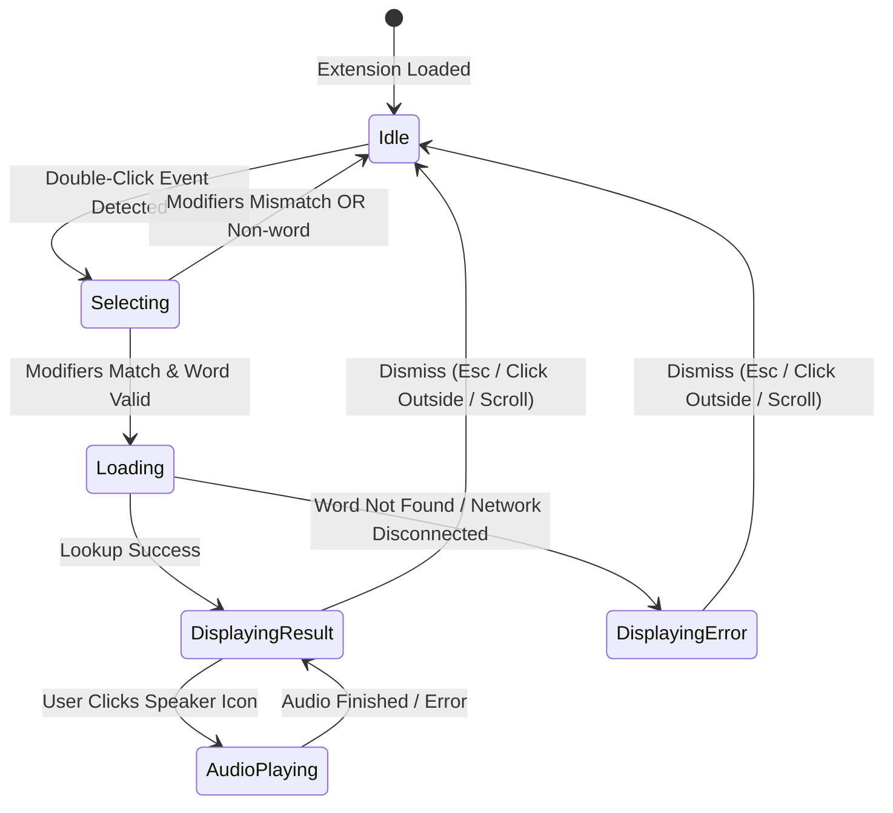

# Phase 1 Data Model: English Dictionary Firefox Addon

**Feature Branch**: `001-dictionary-word-lookup`  
**Date**: 2026-10-16  
**Status**: Completed  

## Entities & Type Definitions

### 1. `WordLookupRequest`

Represents an incoming word lookup triggered by a user double-click interaction on a web page.

| Field | Type | Required | Description |
| :--- | :--- | :--- | :--- |
| `rawText` | `string` | Yes | The raw text captured from `window.getSelection().toString()`. |
| `word` | `string` | Yes | Sanitized word lemma (trimmed, punctuation removed, lowercased). |
| `anchorRect` | `BoundingBox` | Yes | Viewport bounding coordinates of the selected word. |
| `activeModifiers` | `ModifierFlags` | Yes | Boolean flags indicating which keys were depressed during double-click (`altKey`, `ctrlKey`, `shiftKey`, `metaKey`). |

#### Subtypes:
- **`BoundingBox`**:
  ```ts
  interface BoundingBox {
    top: number;
    left: number;
    bottom: number;
    right: number;
    width: number;
    height: number;
  }
  ```
- **`ModifierFlags`**:
  ```ts
  interface ModifierFlags {
    alt: boolean;
    ctrl: boolean;
    shift: boolean;
    meta: boolean;
  }
  ```

---

### 2. `DictionaryEntry`

The normalized dictionary data structure extracted from Free Dictionary API responses.

| Field | Type | Required | Description |
| :--- | :--- | :--- | :--- |
| `word` | `string` | Yes | Canonical capitalized or lowercase headword. |
| `phonetic` | `string \| null` | No | International Phonetic Alphabet (IPA) representation, e.g. `"/prəˌnʌnsiˈeɪʃən/"`. |
| `audioUrl` | `string \| null` | No | Direct URL to `.mp3` spoken pronunciation audio file. |
| `meanings` | `MeaningGroup[]` | Yes | List of definitions grouped by part of speech. |

#### Subtypes:
- **`MeaningGroup`**:
  ```ts
  interface MeaningGroup {
    partOfSpeech: string; // e.g., "noun", "verb", "adjective"
    definitions: DefinitionItem[];
  }
  ```
- **`DefinitionItem`**:
  ```ts
  interface DefinitionItem {
    definition: string;
    example?: string | null;
    synonyms?: string[];
    antonyms?: string[];
  }
  ```

---

### 3. `LookupResult`

The standardized message response sent from the background script service to the active content script.

| Field | Type | Required | Description |
| :--- | :--- | :--- | :--- |
| `status` | `"success" \| "not_found" \| "network_error" \| "error"` | Yes | Outcome status of the lookup operation. |
| `entry` | `DictionaryEntry \| null` | No | Normalized entry data (present when status is `"success"`). |
| `errorMessage` | `string \| null` | No | Human-readable explanation (for empty, network, or error states). |

---

### 4. `TriggerConfiguration`

User preferences persisted in `browser.storage.sync` (with fallback to `browser.storage.local`).

| Field | Type | Default | Validation Rules | Description |
| :--- | :--- | :--- | :--- | :--- |
| `modifierKey` | `"none" \| "alt" \| "ctrl" \| "shift"` | `"none"` | Must be one of the 4 supported string values. | Required key combination modifier. |
| `enabled` | `boolean` | `true` | Must be a boolean. | Global toggle to enable/disable double-click lookups. |
| `theme` | `"auto" \| "light" \| "dark"` | `"auto"` | Must be one of `"auto"`, `"light"`, or `"dark"`. | Theme appearance for popup card. |

---

## State Lifecycle & Transitions


