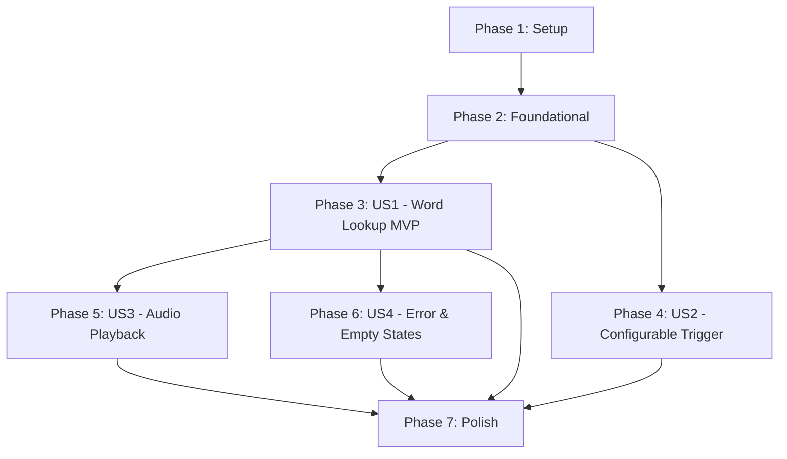

# Tasks: English Dictionary Firefox Addon

**Input**: Design documents from `/specs/001-dictionary-word-lookup/`  
**Prerequisites**: [plan.md](plan.md), [spec.md](spec.md), [research.md](research.md), [data-model.md](data-model.md), [contracts/](contracts/)  

## Format: `- [ ] [ID] [P?] [Story?] Description with file path`

- **[P]**: Can run in parallel (different files, no dependencies on incomplete tasks)
- **[Story]**: Which user story this task belongs to (e.g., [US1], [US2], [US3], [US4])
- File paths are specific and relative to repository root

---

## Phase 1: Setup (Shared Infrastructure)

**Purpose**: Project initialization, manifest definition, and build/test tooling.

- [ ] T001 Initialize npm project with Vitest and web-ext dependencies in package.json
- [ ] T002 [P] Create extension directory layout in src/ and tests/unit/
- [ ] T003 [P] Generate addon icon assets in src/icons/icon-16.png, src/icons/icon-48.png, and src/icons/icon-128.png
- [ ] T004 Create WebExtension Manifest V3 configuration in src/manifest.json

---

## Phase 2: Foundational (Blocking Prerequisites)

**Purpose**: Core data utilities, background service worker, and storage layer that MUST be complete before user stories begin.

**⚠️ CRITICAL**: No user story work can begin until this foundational phase is complete.

- [ ] T005 [P] Implement word sanitization and punctuation stripping utility in src/common/sanitize.js
- [ ] T006 [P] Implement storage configuration helper with default preferences in src/common/storage.js
- [ ] T007 [P] Implement Free Dictionary API client and response normalizer in src/background/dictionary-service.js
- [ ] T008 Implement background runtime message dispatcher for LOOKUP_WORD and GET_CONFIG in src/background/background.js
- [ ] T009 [P] Implement unit tests for word sanitization logic in tests/unit/sanitize.test.js
- [ ] T010 [P] Implement unit tests for dictionary response normalizer in tests/unit/dictionary-service.test.js

**Checkpoint**: Foundation ready — all user story development can now proceed.

---

## Phase 3: User Story 1 - Quick Word Lookup via Double-Click (Priority: P1) 🎯 MVP

**Goal**: When a user double-clicks any word on a webpage, a floating popup card appears near the word displaying phonetic pronunciation, part of speech, definitions, and usage examples.

**Independent Test**: Double-click an English word on any webpage; verify an anchored popup card appears near the word displaying definition, phonetics, part of speech, and dismisses on click-outside, Escape, or scroll.

- [ ] T011 [P] [US1] Implement viewport boundary collision and anchor positioning algorithm in src/common/position.js
- [ ] T012 [P] [US1] Implement unit tests for positioning and edge-flipping logic in tests/unit/position.test.js
- [ ] T013 [US1] Create Shadow DOM popup component structure and dismiss handlers in src/content/popup-view.js
- [ ] T014 [P] [US1] Create modern, rich CSS styles and animations for the Shadow DOM popup card in src/content/popup.css
- [ ] T015 [US1] Implement double-click event listener, text extraction, and background message coordination in src/content/content.js

**Checkpoint**: User Story 1 is fully functional and delivers the core MVP lookup experience.

---

## Phase 4: User Story 2 - Configurable Trigger Key Combination (Priority: P2)

**Goal**: Users can require an optional modifier key (Alt, Ctrl, or Shift) in combination with double-click to look up words, avoiding interference with normal text selection.

**Independent Test**: Set trigger preference to "Alt + Double-click" in the addon options page; verify that double-clicking alone only selects text, and holding Alt while double-clicking triggers the dictionary popup.

- [ ] T016 [P] [US2] Implement modifier key condition matching (none, alt, ctrl, shift) in src/content/content.js
- [ ] T017 [P] [US2] Build options page user interface with trigger modifier selector in src/options/options.html
- [ ] T018 [P] [US2] Create responsive styling for the options page in src/options/options.css
- [ ] T019 [US2] Implement settings save/load and configuration broadcasting logic in src/options/options.js
- [ ] T020 [P] [US2] Implement unit tests for storage schema and defaults in tests/unit/storage.test.js

**Checkpoint**: User Stories 1 AND 2 operate seamlessly together with customizable trigger controls.

---

## Phase 5: User Story 3 - Audio Pronunciation Playback (Priority: P3)

**Goal**: Users can click an interactive speaker icon in the popup card to listen to spoken pronunciation of the word.

**Independent Test**: Double-click a word with an audio recording; click the speaker button; verify clear audio playback with playing state visual feedback.

- [ ] T021 [US3] Implement audio element playback and playing-state animation logic in src/content/popup-view.js
- [ ] T022 [P] [US3] Add speaker button iconography, hover states, and playing animations in src/content/popup.css

**Checkpoint**: Pronunciation audio playback is fully integrated into the popup card.

---

## Phase 6: User Story 4 - Resilient Error & Empty State Feedback (Priority: P4)

**Goal**: Provide clear, polite, and non-intrusive feedback when a word is not found or when network connectivity is lost.

**Independent Test**: Double-click a non-existent word or disconnect network; verify an informative card appears with a friendly message rather than freezing or failing silently.

- [ ] T023 [US4] Implement network timeout and 404 error translation in src/background/dictionary-service.js
- [ ] T024 [US4] Implement not-found and offline notification views in src/content/popup-view.js
- [ ] T025 [P] [US4] Add styling for loading state spinner, not-found notice, and offline badge in src/content/popup.css

**Checkpoint**: All user stories (P1 through P4) are fully functional, resilient, and independently testable.

---

## Phase 7: Polish & Cross-Cutting Concerns

**Purpose**: Linting, packaging validation, documentation, and end-to-end verification.

- [ ] T026 [P] Configure web-ext lint script and validate extension manifest in package.json
- [ ] T027 [P] Document addon installation, options configuration, and developer testing in README.md
- [ ] T028 Perform end-to-end manual testing across complex web contexts and edge cases per specs/001-dictionary-word-lookup/quickstart.md

---

## Dependencies & Execution Order

### Phase Dependencies

- **Setup (Phase 1)**: Can start immediately.
- **Foundational (Phase 2)**: Depends on Setup (T001-T004) completion. Blocks all user stories.
- **User Story 1 (Phase 3 - MVP)**: Can start as soon as Phase 2 completes.
- **User Story 2 (Phase 4)**: Can proceed in parallel with or after US1.
- **User Story 3 (Phase 5)**: Extends US1 popup with audio controls.
- **User Story 4 (Phase 6)**: Extends US1 popup with error/offline cards.
- **Polish (Phase 7)**: Depends on desired story completion.

---

## Parallel Opportunities

- **Setup Phase**: T002 (directories) and T003 (icons) can run in parallel.
- **Foundational Phase**: T005 (`sanitize.js`), T006 (`storage.js`), and T007 (`dictionary-service.js`) can all be developed simultaneously in parallel. T009 and T010 unit tests can run in parallel with implementations.
- **User Story 1**: T011 (`position.js`) and T014 (`popup.css`) can run in parallel before T015 integrates them into `content.js`.
- **User Story 2**: T016 (content script trigger), T017/T018 (options UI), and T020 (storage unit tests) can run in parallel.
- **User Story 3 & 4**: T022 (`popup.css` audio styles) and T025 (`popup.css` error styles) can be styled in parallel.

---

## Implementation Strategy

### MVP First (User Story 1)

1. Complete Phase 1: Setup (T001–T004)
2. Complete Phase 2: Foundational (T005–T010)
3. Complete Phase 3: User Story 1 (T011–T015)
4. **STOP and VALIDATE**: Load extension temporarily in Firefox, double-click any word, and verify definition popup appears. (Deliverable MVP!)

### Incremental Feature Additions

1. Add User Story 2 (T016–T020): Adds options UI and modifier key options.
2. Add User Story 3 (T021–T022): Adds audio pronunciation.
3. Add User Story 4 (T023–T025): Adds resilient offline and 404 error states.
4. Final Polish (T026–T028): Linting, packaging, and final quickstart walkthrough.
