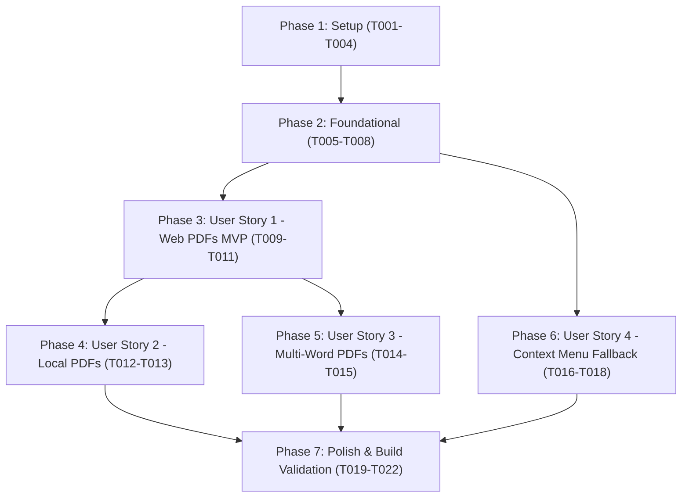

# Tasks: PDF Document Dictionary Support

**Input**: Design documents from `/specs/004-pdf-dictionary-support/`  
**Prerequisites**: [plan.md](plan.md), [spec.md](spec.md), [checklists/requirements.md](checklists/requirements.md)  

## Format: `[ID] [P?] [Story] Description`

- **[P]**: Can run in parallel (different files, no blocking dependencies)
- **[Story]**: Associated user story (`[US1]` through `[US4]` from spec.md)
- Every task includes explicit file paths

---

## Phase 1: Setup (Manifests & Permissions Configuration)

**Purpose**: Update extension manifests with `contextMenus` permission and enable content script execution across sub-frames and embeds.

- [X] T001 Update Chrome Manifest V3 with `contextMenus` permission and `all_frames: true`, `match_about_blank: true` in `src/manifest.chrome.json`
- [X] T002 [P] Update Firefox Manifest V3 with `contextMenus` permission and `all_frames: true`, `match_about_blank: true` in `src/manifest.firefox.json`
- [X] T003 [P] Update base manifest template with `contextMenus` permission and `all_frames: true`, `match_about_blank: true` in `src/manifest.json`
- [X] T004 [P] Update manifest validation tests in `tests/unit/manifest.test.js` to assert `contextMenus` permission and `all_frames: true` in all manifest configurations

---

## Phase 2: Foundational (Text Sanitization & Fallback Positioning)

**Purpose**: Core string sanitization and viewport positioning infrastructure required before user story features can be tested.

**⚠️ CRITICAL**: Must complete before user story implementations begin.

- [X] T005 Enhance `sanitizeDomainTerm` and `sanitizeWord` in `src/common/sanitize.js` to de-hyphenate line-break splits and strip soft hyphens (`\u00AD`) from PDF text extracts
- [X] T006 [P] Add unit test cases for PDF line-break de-hyphenation and soft hyphen removal in `tests/unit/sanitize.test.js`
- [X] T007 Enhance `calculatePopupPosition` in `src/common/position.js` to support fallback viewport centering when `anchorRect` has zero width/height
- [X] T008 [P] Add unit test cases for zero-dimension and missing `anchorRect` fallback positioning in `tests/unit/position.test.js`

**Checkpoint**: Foundational sanitization and positioning helpers ready — user story implementations can proceed.

---

## Phase 3: User Story 1 - Instant Word Lookup in Web-Hosted PDF Documents (Priority: P1) 🎯 MVP

**Goal**: Deliver double-click word lookup, phonetic transcription, definitions, and audio pronunciation on online PDFs in Google Chrome and Mozilla Firefox.

**Independent Test**: Open any online PDF document (e.g. `https://www.w3.org/WAI/ER/tests/xhtml/testfiles/resources/pdf/dummy.pdf`), double-click a word, and verify that the floating dictionary popup appears anchored to the word displaying phonetics, meanings, and plays pronunciation audio on click.

### Implementation for User Story 1

- [X] T009 [US1] Update `src/content/content.js` to handle PDF document DOM structures and ensure text selection settlement in PDF.js text layers on double-click
- [X] T010 [P] [US1] Verify and ensure Shadow DOM styles in `src/content/popup-view.js` maintain high z-index and zero visual clipping over native PDF viewer canvas layers
- [X] T011 [US1] Verify dismiss triggers (Escape key, click outside, scroll) in `src/content/popup-view.js` dismiss popups cleanly without disrupting PDF navigation

**Checkpoint**: User Story 1 functional — MVP dictionary lookup operational on web-hosted PDF documents.

---

## Phase 4: User Story 2 - Word Lookup in Local PDF Documents (Priority: P2)

**Goal**: Support local `file://` PDF lookups and provide in-browser guidance with live status indicator for local file access permissions.

**Independent Test**: Open extension options page, check the Local PDF File Access status badge, verify instructions for enabling `file://` permissions, and verify lookups function when local file access is enabled.

### Implementation for User Story 2

- [X] T012 [P] [US2] Implement `isAllowedFileSchemeAccess()` query and permission state helper in `src/options/options.js`
- [X] T013 [US2] Add Local PDF File Access status card with live badge and browser-specific setup instructions in `src/options/options.html` and `src/options/options.css`

**Checkpoint**: User Story 2 functional — Local PDF lookups supported with clear permission setup guidance.

---

## Phase 5: User Story 3 - Multi-Word Terms and Phrases in PDF Documents (Priority: P3)

**Goal**: Support 2-to-4 word phrase selection and floating icon trigger within PDF documents.

**Independent Test**: Drag-select a 2-to-4 word compound term in a browser-opened PDF, verify the floating dictionary trigger icon appears, and click it to view compound definitions.

### Implementation for User Story 3

- [X] T014 [US3] Verify `mouseup` multi-word drag selection and floating trigger placement over PDF viewer text layers in `src/content/content.js` and `src/content/floating-icon.js`
- [X] T015 [P] [US3] Verify modifier key (Alt/Ctrl/Shift + drag) phrase lookup execution in `src/content/content.js` on PDF documents

**Checkpoint**: User Story 3 functional — Multi-word domain terms and phrase selections operational on PDFs.

---

## Phase 6: User Story 4 - Context Menu and Viewer Fallback Lookup (Priority: P4)

**Goal**: Provide a right-click context menu option to look up selected text as a 100% reliable fallback across all PDF viewers and sandboxed plugin embeds.

**Independent Test**: Select any word or phrase in a PDF, right-click, select "Look up in Simple English Dictionary", and verify that the dictionary popup opens with definitions for the selected text.

### Implementation for User Story 4

- [X] T016 [US4] Implement context menu registration (`contextMenus.create`) and selection click dispatcher in `src/background/background.js`
- [X] T017 [US4] Implement `TRIGGER_SELECTION_LOOKUP` message listener and fallback viewport anchoring in `src/content/content.js`
- [X] T018 [P] [US4] Create unit test suite for context menu registration and message handling in `tests/unit/context-menu.test.js`

**Checkpoint**: User Story 4 functional — Context menu lookup available across all PDF documents and web pages.

---

## Phase 7: Polish & Cross-Cutting Concerns

**Purpose**: Complete documentation, build all target distributions, and verify tests and linting.

- [X] T019 [P] Update `README.md` with PDF lookup documentation, context menu instructions, and local file permission guidance
- [X] T020 Run complete build pipeline with `npm run build` to update `dist/chrome`, `dist/firefox`, and in-source bundles
- [X] T021 Run complete test suite with `npm test` to verify all unit tests pass with zero regressions
- [X] T022 Run Firefox addon linter with `npm run lint` to verify zero manifest or bundle errors

---

## Dependencies & Execution Order

### Parallel Opportunities

- **Phase 1**: T002, T003, T004 can run in parallel after T001.
- **Phase 2**: T006 can run in parallel with T005; T008 can run in parallel with T007.
- **Phase 3**: T010 can run in parallel with T009.
- **Phase 4 & 5 & 6**: User Stories 2, 3, and 4 can be implemented incrementally in parallel once Foundational and US1 are in place.
- **Phase 7**: T019 can run in parallel with T020.
